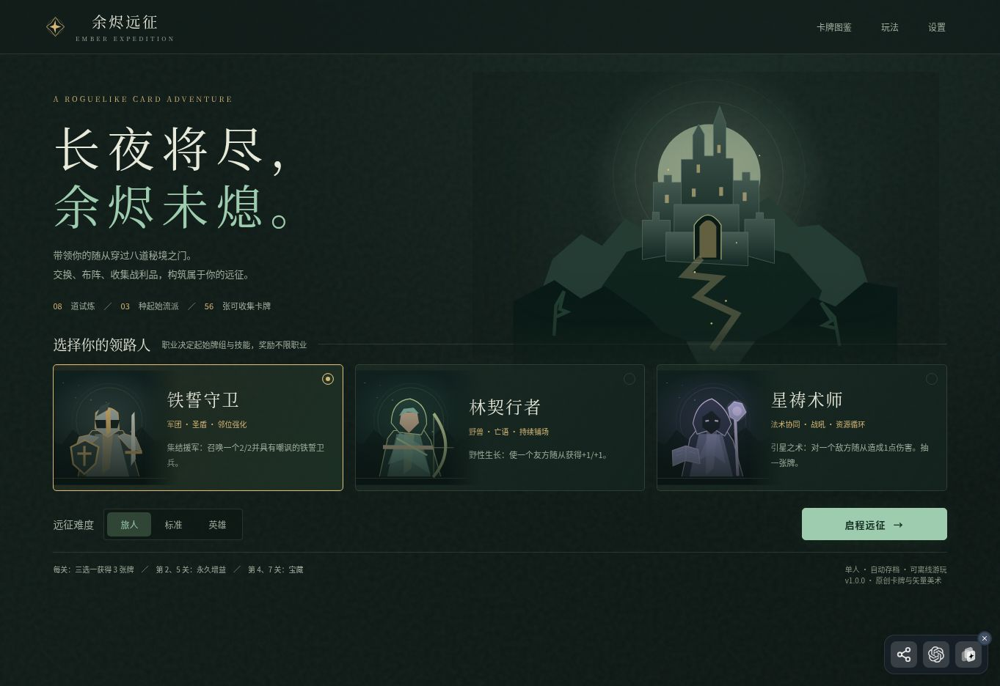

# CLRedfield · Rosepineus

**独立游戏开发者 / Indie Game Developer**  
上海交通大学学生 · 用可玩的作品表达想法  
Shanghai Jiao Tong University student · Turning ideas into playable games

**[试玩楚河弈策 / Play CardChess](https://clredfield.github.io/CardChess/)** · **[试玩余烬远征 / Play Ember Expedition](https://ember-expedition-5jwyc6.v2.appdeploy.ai/)**

---

## 精选作品 / Playable Games

两款已公开提供试玩的原创网页游戏。打开浏览器，就能体验。  
Two original browser games with public playable builds. Jump in directly from your browser.

### 01 · 楚河弈策 / CardChess

**以牌布势，以棋成局。 / Shape the board with cards. Win with your next move.**

中国象棋与卡组构筑结合：花法力部署棋子、使用法术，再用每回合的一步棋推进局面。新部署的棋子需要待命，但会立即改变阻挡、炮架与进攻线路。  
Xiangqi meets deckbuilding: spend mana to deploy pieces and cast spells, then make one board move each turn. New pieces must wait before moving, but immediately reshape blocking, cannon screens, and attack lines.

- **策略构筑 / Deckbuilding** — 16 种核心卡、24 张卡组与三套预设。 / 16 core card types, 24-card decks, and three presets.
- **多种对局 / Ways to play** — 单机 AI、同屏双人与好友房间联机。 / Local AI, same-device play, and online friend rooms.
- **学习与复盘 / Learn and review** — 军师建议、五节实战教学、行动历史与卡组编辑。 / Advisor suggestions, five tutorials, action history, and a deck editor.

**[▶ 在线试玩 / Play](https://clredfield.github.io/CardChess/)** · **[↗ 源码仓库 / Source](https://github.com/CLRedfield/CardChess)**

状态：可玩版本 v1.1，规则与数值持续调整。GitHub Pages 通过仓库工作流发布；军师采用有限搜索，不保证最优。 / Status: playable v1.1; rules and balance continue to evolve. Published through the repository's GitHub Pages workflow; advisor suggestions use bounded search and are not guaranteed optimal.

---

### 02 · 余烬远征 / Ember Expedition

**长夜将尽，余烬未熄。 / Through eight trials, keep the embers alive.**

以随从交互为核心的八关网页卡牌肉鸽。围绕站位、交换与关键词组合建立场面，每次胜利从三组奖励中选择一整组卡牌，让构筑在远征中逐渐成形。  
An eight-stage roguelike deckbuilder built around tactical minion combat. Combine positioning, trades, and card keywords; after each victory, choose one of three card packs to grow your build.

- **三种职业 / Three classes** — 铁誓守卫、林契行者、星祷术师，各有起始牌组与技能。 / Three classes with distinct starting decks and hero powers.
- **八关成长 / Eight-stage progression** — 56 张可收集卡牌、八位首领、永久增益与宝藏。 / 56 collectible cards, eight bosses, permanent buffs, and treasures.
- **战术与取舍 / Tactical choices** — 嘲讽、圣盾、亡语、邻位光环，以及营地回血、删牌和减费。 / Taunt, shields, deathrattles, adjacency auras, and camp choices to heal, remove cards, or reduce costs.

**[▶ 在线试玩 / Play](https://ember-expedition-5jwyc6.v2.appdeploy.ai/)** · **[↗ 源码仓库 / Source](https://github.com/CLRedfield/ember-expedition)**

状态：可玩发布快照。线上试玩固定于源码提交 <a href="https://github.com/CLRedfield/ember-expedition/commit/fd8f21270d5882810ce91b69ca628963e0461514">fd8f212</a>，尚未配置自动重新部署；最新源码请查看仓库。 / Status: playable release snapshot. The hosted build uses commit fd8f212 and does not automatically redeploy when source changes; see the repository for the latest code.

---

## 关于我 / About Me

我是 Rosepineus，上海交通大学学生，喜欢把有趣的规则组合做成可以直接玩的小游戏。正在探索独立游戏开发与游戏创业，也在学习如何与同学一起把作品做得更完整。  
I'm Rosepineus, a student at Shanghai Jiao Tong University. I enjoy turning unusual combinations of rules into playable games. I'm exploring indie game development and entrepreneurship, while learning to build more complete projects with fellow students.

**开发关注 / Development Focus**

- 策略与卡牌系统：棋盘规则、卡组构筑、肉鸽成长。 / Strategy and card systems: board rules, deckbuilding, and roguelike progression.
- 浏览器可玩体验：交互界面、本地 AI 与好友联机。 / Browser-based play: interactive interfaces, local AI, and friend multiplayer.
- 从规则到体验：教学、复盘、存档与可试玩交付。 / From rules to experience: tutorials, review tools, saves, and playable releases.

**B 站 / Bilibili：Rosepineus**  
欢迎先试玩，再通过对应仓库的 Issues 留下反馈。 / Try a game and share feedback through its repository's Issues.

以上图片为线上游戏实际界面截图（2026-10-13）。此页展示可玩个人作品，商业发行状态以各项目说明为准。 / Screenshots captured from the live games on October 13, 2026. This page showcases playable personal projects; see each repository for release details.
